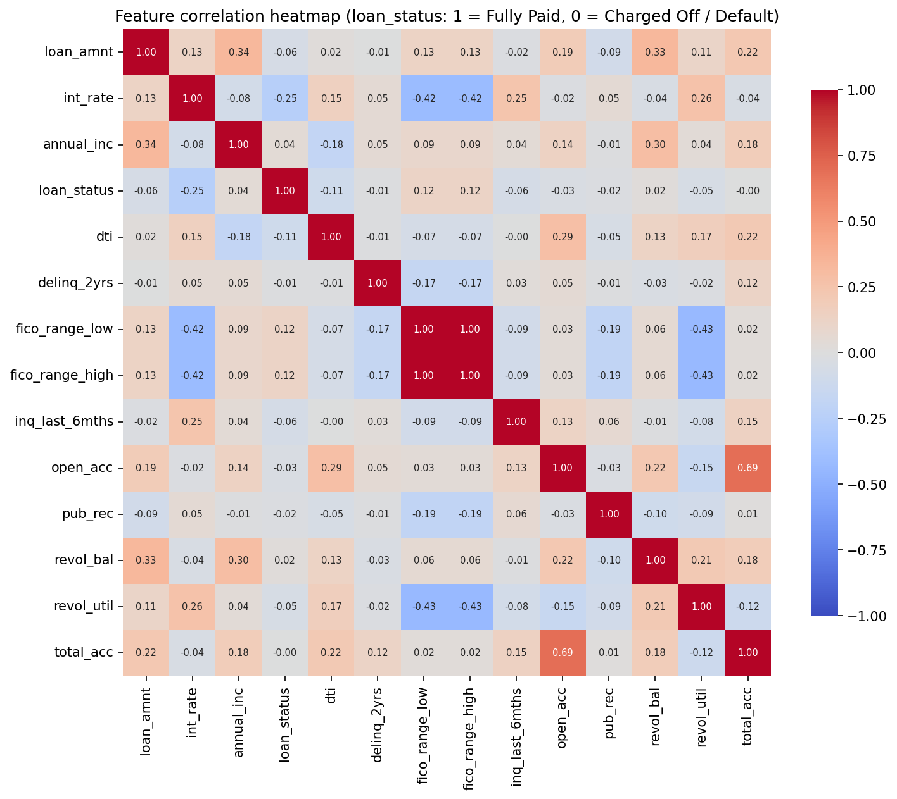
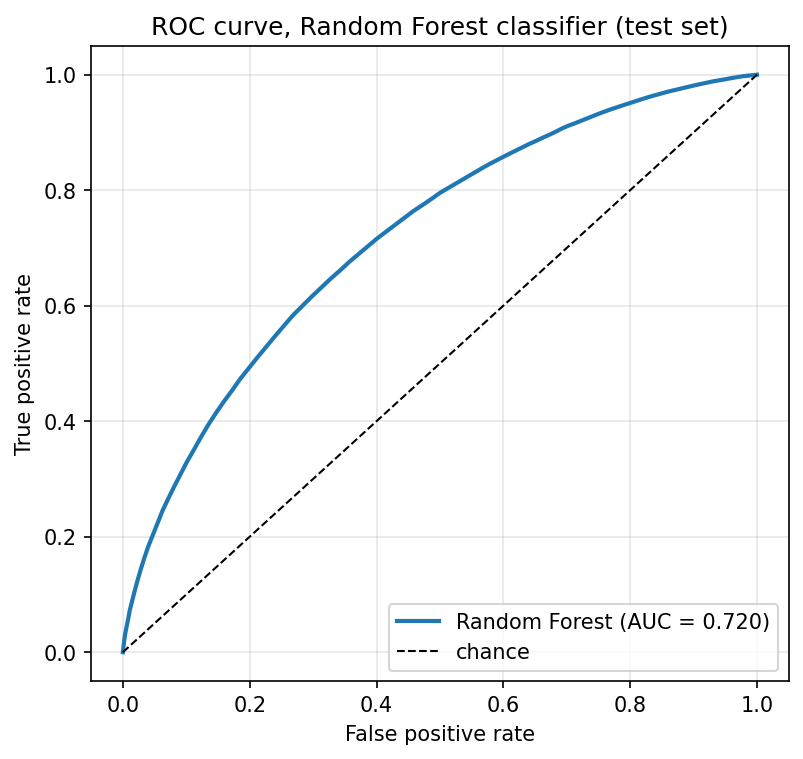
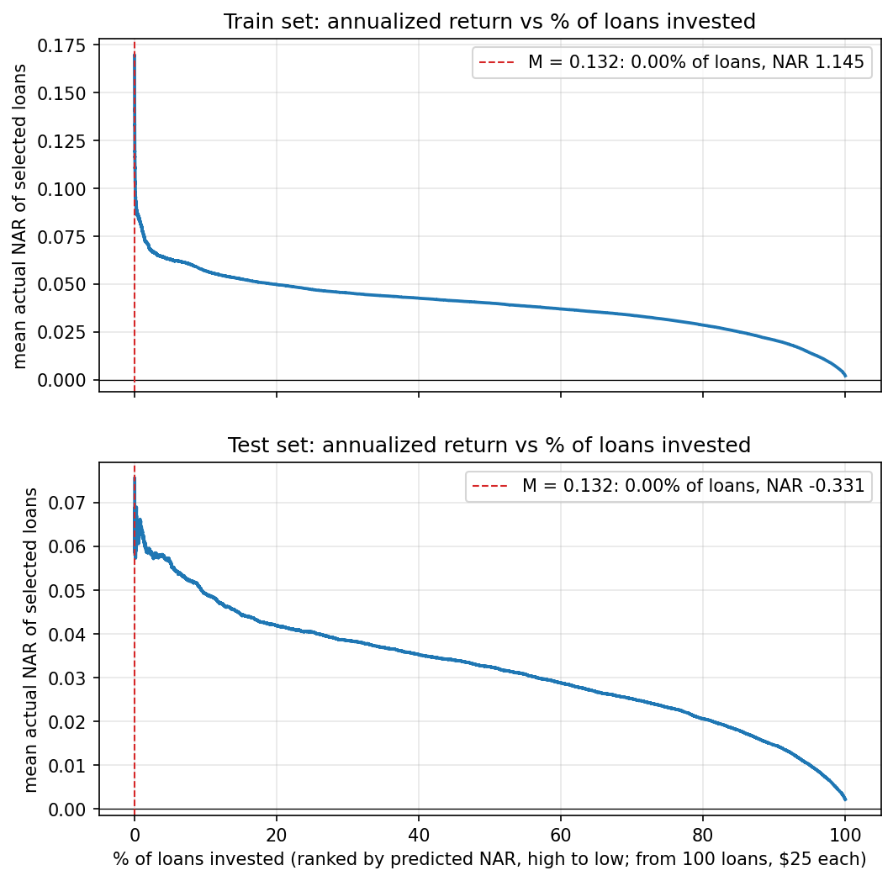

# Results: replication vs paper

Paper: Li & Han, *LendingClub Loan Default and Profitability Prediction* (Stanford CS229), `paper.pdf`. "Mine" = this repository, produced by `python src/run_all.py`. All metrics are on the **test set** unless stated. Underlying tables: `results/tables/`; decisions where the paper is vague: `ASSUMPTIONS.md`.

## 1. Dataset and preprocessing (Section III)

| Quantity | Mine | Paper |
|---|---:|---:|
| Loans (2012-2015, final status) | 786,820 | 745,529 |
| Positive (Fully Paid) | 81.4% | ~81% |
| Negative (Charged Off + Default) | 18.6% | ~19% |
| Train / test rows | 550,774 / 236,046 | 521,870 / 223,659 |
| Features after preprocessing | 1,126 | 1,097 |
| PCA components for 95% variance | 951 (84% of features) | ~900 (82% of features) |

Correlation heatmap (paper Fig. 1):

## 2. Classification (Section V)

Precision / recall / F1 on the test set.

| Model | Class | Mine P / R / F1 | Paper P / R / F1 |
|---|---|---|---|
| Logistic Regression | Default | 0.31 / 0.67 / 0.42 | 0.63 / 0.88 / 0.73 |
| Logistic Regression | Paid Off | 0.90 / 0.66 / 0.76 | 0.97 / 0.88 / 0.92 |
| Logistic Regression | weighted avg | 0.79 / 0.66 / 0.70 | 0.90 / 0.88 / 0.88 |
| Neural Network (10,10,5,3) | Default | 0.49 / 0.12 / 0.19 | 0.72 / 0.71 / 0.72 |
| Neural Network (10,10,5,3) | Paid Off | 0.83 / 0.97 / 0.89 | 0.93 / 0.93 / 0.93 |
| Neural Network (10,10,5,3) | weighted avg | 0.77 / 0.81 / 0.76 | 0.89 / 0.89 / 0.89 |
| Random Forest (200 trees) | Default | 0.58 / 0.06 / 0.11 | 0.76 / 0.65 / 0.70 |
| Random Forest (200 trees) | Paid Off | 0.82 / 0.99 / 0.90 | 0.92 / 0.95 / 0.94 |
| Random Forest (200 trees) | weighted avg | 0.78 / 0.82 / 0.75 | 0.89 / 0.89 / 0.89 |

| Model | Train weighted P / R / F1 (mine) | Train weighted (paper) | Test AUC (mine) | Test AUC (poster) |
|---|---|---|---:|---:|
| Logistic Regression | 0.79 / 0.66 / 0.70 | not reported |  |  |
| Neural Network (10,10,5,3) | 0.79 / 0.82 / 0.78 | 0.91 / 0.91 / 0.91 |  |  |
| Random Forest (200 trees) | 1.00 / 1.00 / 1.00 | 0.97 / 0.96 / 0.96 | 0.720 | 0.94 |

The AUC of 0.94 comes from the ROC figure on the authors' poster; the paper reports no AUC. The paper and the poster disagree on how well the Random Forest fits the training set: the paper's train table gives weighted F1 0.96 (Default recall 0.82), while the poster's train confusion matrix is perfect (99,163 / 0 / 0 / 422,707), as it is in this replication.

Test confusion matrices (rows = true class, columns = predicted class):

| Model | True class | Mine: pred. Default | Mine: pred. Paid Off | Paper: pred. Default | Paper: pred. Paid Off |
|---|---|---:|---:|---:|---:|
| Logistic Regression | True Default | 29,330 | 14,660 | 37,632 | 5,135 |
| Logistic Regression | True Paid Off | 65,357 | 126,699 | 22,448 | 158,444 |
| Neural Network (10,10,5,3) | True Default | 5,323 | 38,667 | 30,545 | 12,222 |
| Neural Network (10,10,5,3) | True Paid Off | 5,541 | 186,515 | 11,864 | 169,028 |
| Random Forest (200 trees) | True Default | 2,641 | 41,349 | 27,760 | 15,007 |
| Random Forest (200 trees) | True Paid Off | 1,899 | 190,157 | 8,750 | 172,142 |

Train confusion matrices and full reports: `results/tables/03_*`. ROC curve: 

## 3. Regression on net annualized return (Sections VI-VII)

NAR = (total_pymnt / loan_amnt)^(365/D) - 1, D = days from issue_d to last_pymnt_d.

Loans without a usable last-payment date (missing, or not after the issue date) are excluded from the regression and from the loan selection; the classifiers still use every loan.

| Split | Loans | Excluded: last_pymnt_d missing | Excluded: D <= 0 | Excluded total | of which Charged Off / Default | of which Fully Paid | Kept for regression | Kept, D floored to 30 days |
|---|---:|---:|---:|---:|---:|---:|---:|---:|
| train | 550,774 | 413 | 803 | 1,216 | 414 | 802 | 549,558 | 350 |
| test | 236,046 | 174 | 327 | 501 | 174 | 327 | 235,545 | 146 |

Paper claim "most NARs of defaulted loans are well below -0.5": in this data **33.7%** of Charged Off / Default loans have NAR < -0.5 (53.7% are below -0.25). Distribution: `results/tables/04_nar_distribution.md`, figure `figures/nar_distribution.png`.

| Model | Train MSE mine / paper | Train R2 mine / paper | Test MSE mine / paper | Test R2 mine / paper |
|---|---|---|---|---|
| Linear Regression | 0.053 / 0.040 | 0.039 / 0.243 | 0.053 / 5.014 | 0.034 / -9.494e+22 |
| Ridge (alpha=1) | 0.053 / 0.040 | 0.039 / 0.243 | 0.053 / 0.040 | 0.034 / 0.238 |
| Neural Network (20,10,5,3) | 0.048 / 0.036 | 0.117 / 0.324 | 0.054 / 0.037 | 0.004 / 0.306 |
| Random Forest, depth 4 | 0.053 / 0.037 | 0.030 / 0.298 | 0.053 / 0.037 | 0.030 / 0.295 |
| Random Forest, depth 8 | 0.052 / 0.035 | 0.053 / 0.329 | 0.052 / 0.036 | 0.039 / 0.312 |
| Random Forest, depth 10 | 0.051 / 0.034 | 0.075 / 0.356 | 0.052 / 0.036 | 0.040 / 0.315 |

## 4. Loan selection strategy (Section VIII), RF depth-10 predictions

Percentages are of the loans kept for the regression (see the exclusion table in section 3).

| Split | Loans with predicted NAR > 0.132 (mine) | Mean actual NAR of those loans (mine) | Mean NAR of all loans (mine) | Paper |
|---|---:|---:|---:|---|
| train | 0.00% (3 loans) | 114.5% | 0.2% | ~1.76% of loans, ~15% NAR |
| test | 0.00% (3 loans) | -33.1% | 0.2% | ~1.76% of loans, ~15% NAR |

Sweep over the threshold M (share of loans selected and their mean actual NAR):

| M | Train % selected | Train NAR | Test % selected | Test NAR |
|---:|---:|---:|---:|---:|
| 0.05 | 0.19% | 9.4% | 0.18% | 6.0% |
| 0.06 | 0.00% | 76.3% | 0.00% | -23.4% |
| 0.07 | 0.00% | 89.9% | 0.00% | -23.4% |
| 0.08 | 0.00% | 89.9% | 0.00% | -23.4% |
| 0.09 | 0.00% | 89.9% | 0.00% | -33.1% |
| 0.10 | 0.00% | 89.9% | 0.00% | -33.1% |
| 0.11 | 0.00% | 89.9% | 0.00% | -33.1% |
| 0.12 | 0.00% | 89.9% | 0.00% | -33.1% |
| 0.13 | 0.00% | 114.5% | 0.00% | -33.1% |
| 0.14 | 0.00% | 114.5% | 0.00% | -41.6% |
| 0.15 | 0.00% | 114.5% | 0.00% | -41.6% |
| 0.16 | 0.00% | 114.5% | 0.00% | -41.6% |
| 0.17 | 0.00% | 114.5% | 0.00% | -41.6% |
| 0.18 | 0.00% | 114.5% | 0.00% | -41.6% |
| 0.19 | 0.00% | 114.5% | 0.00% | -41.6% |
| 0.20 | 0.00% | 114.5% | 0.00% | -41.6% |

Annualized return vs share of loans invested (paper Fig. 2):

## 5. Where the results differ from the paper, and why

Large gaps found in this run:

- Logistic Regression: weighted F1 0.70 vs 0.88
- Neural Network (10,10,5,3): weighted F1 0.76 vs 0.89
- Random Forest (200 trees): weighted F1 0.75 vs 0.89
- Random Forest AUC 0.720 vs 0.94 (poster)
- Ridge (alpha=1): test R2 0.034 vs 0.238
- Neural Network (20,10,5,3): test R2 0.004 vs 0.306
- Random Forest, depth 4: test R2 0.030 vs 0.295
- Random Forest, depth 8: test R2 0.039 vs 0.312
- Random Forest, depth 10: test R2 0.040 vs 0.315
- selection at M=0.132: 0.00% of test loans, NAR -33.1% vs 1.76% / 15%

**What matches.** The dataset definition (years, final statuses, class balance), the size of the
feature space, the PCA finding (95% of the variance needs most of the components, so no useful reduction) and the
scale of the NAR label (its variance is close to the ~0.053 implied by the paper's MSE and R2) are all close to the paper.

**Classification and regression quality are much lower than the paper's.** The paper does not list which
columns it dropped. This replication removes every outcome / post-issuance column (payments received, recoveries,
last payment date and amount, last FICO, outstanding principal, hardship and settlement fields; full list in
`ASSUMPTIONS.md`), so the models only see what was known when the loan was issued. With those features the
models are only moderately better than the base rate. The authors' numbers (AUC 0.94 on the poster, 88% recall on
defaults for a linear model, R2 of 0.24 for ridge regression on returns) are far above that. The most likely explanation is that
some post-issuance columns were still among the paper's 1,097 features, which would make the targets partly
predictable from their own consequences. **This is a hypothesis, not something this replication has tested**:
testing it would mean deliberately adding leaking columns back, which is outside the "replicate only" scope.
Smaller contributors that cannot produce a gap this large on their own: a newer data snapshot (more 2015 loans have
reached a final status), unknown imputation groups and max-set factor, unknown logistic-regression strength,
and the unknown number of trees and `max_features` of the regression forests.

**Linear regression did **not** blow up here** (test R2 = 0.034; paper: about -1e23). In this pipeline
the scaler is fit on the training rows only, so a one-hot column that is constant in train stays exactly zero
after centring and receives a zero coefficient, and scikit-learn's least-squares solver returns the minimum-norm
solution for the collinear one-hot columns. A blow-up of the paper's size needs a column that is numerically
almost, but not exactly, constant in train and takes a large value in a few test rows (for example a rare zip
code after scaling with statistics from the whole dataset); such a column gets an enormous coefficient that only
shows up on the test set. That mechanism is an explanation consistent with the paper's description
("high-variance problem"), not one that was reproduced here. Note also that the paper's own pair of numbers
(test MSE 5.014 with R2 = -9.5e22) cannot both be right for a label with variance ~0.05.

**NAR of defaulted loans.** The paper says most defaulted loans have NAR well below -0.5; here 34% do.
Many charged-off borrowers pay for a year or more before stopping, which gives a moderate negative annualized
return rather than a near-total loss.

**Loan selection.** Because the regressors explain little of the NAR variance, predicted NARs are compressed
towards the mean (in the full run 99.9% of the predictions are below 0.052). Only 3 / 3 loans (train / test)
exceed the paper's threshold M = 0.132, so the strategy cannot be reproduced at that threshold: the returns
reported for it rest on a handful of loans and are not meaningful, and in the full run the train figure is
dominated by a single charged-off loan with NAR 3.14. The sweep table shows the selection at lower thresholds.

**Loans without a usable last-payment date.** 1,717 loans (588 Charged Off / Default, 1,129 Fully
Paid) have a missing `last_pymnt_d` or one that is not after `issue_d`, so D cannot be computed. A first version
of this replication set D to 30 days for them. For charged-off loans in that group that had nevertheless paid
back more than their principal, that rule produced impossible labels (NAR up to 22), which the regression forest
partly memorized and which inflated the train-set selection return. They were artifacts of the 30-day rule, not
real returns, so these loans are now excluded from the regression and from the loan selection (classification is
unaffected). Kept loans with NAR above 1: 8 (largest NAR 3.18). In the full data these are charged-off
loans whose recorded last payment falls one or two months after issue although more than the principal was paid back.

## 6. Runtime of this run

| Stage | Step | Time | Peak RAM of the process (GB) |
|---|---|---:|---:|
| 01_load_filter | total | 2.3 min | 2.54 |
| 02_preprocess | total | 2.8 min | 8.66 |
| 03_classification | fit logreg | 3.0 min | 7.10 |
| 03_classification | fit mlp | 8.5 min | 7.10 |
| 03_classification | fit rf | 21.8 min | 7.10 |
| 04_regression | fit linear | 46.8s | 14.10 |
| 04_regression | fit mlp | 5.2 min | 14.10 |
| 04_regression | fit rf10 | 60.0 min | 4.88 |
| 04_regression | fit rf4 | 45.9 min | 4.88 |
| 04_regression | fit rf8 | 25.0 min | 4.88 |
| 04_regression | fit ridge | 8.4s | 14.10 |
| 05_loan_selection | total | 0.5s | 0.18 |

