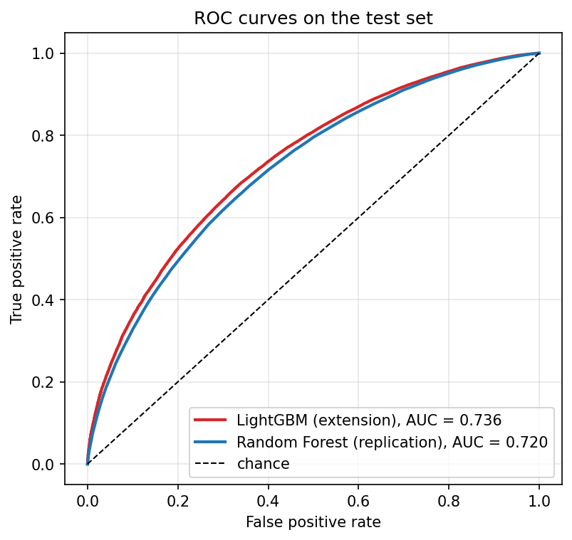
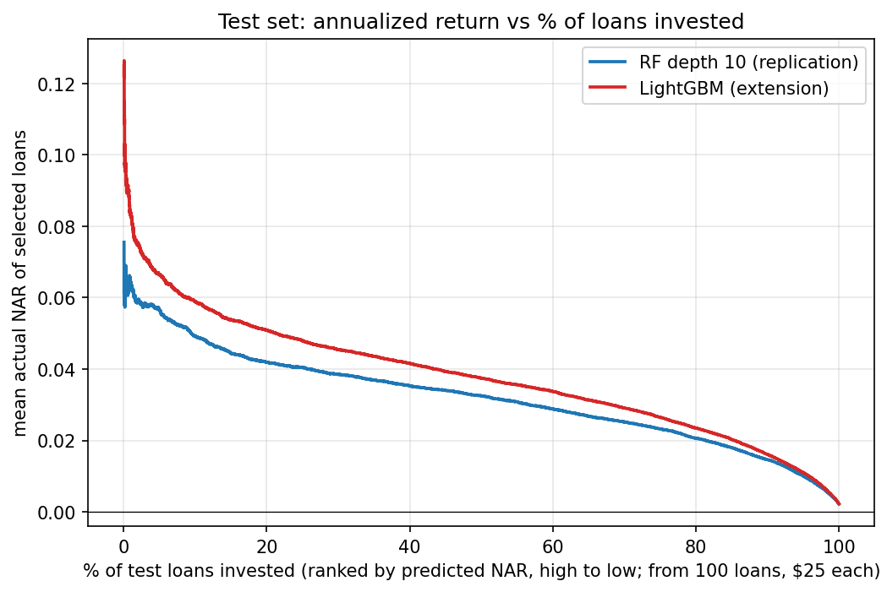
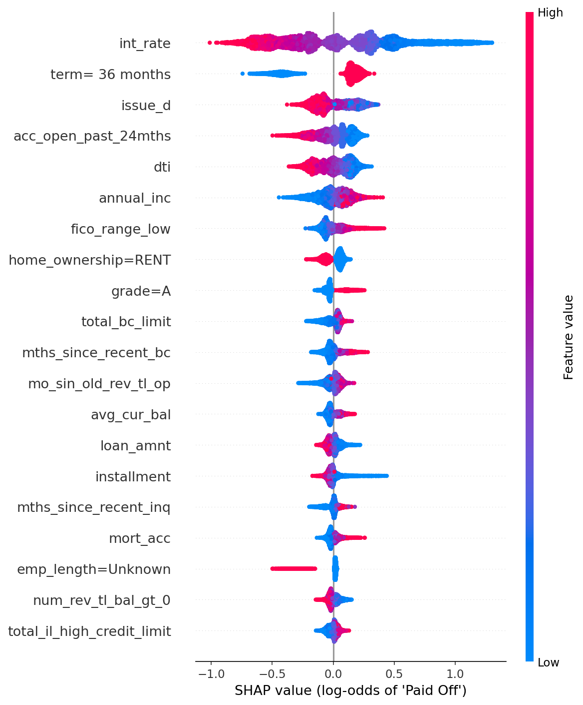
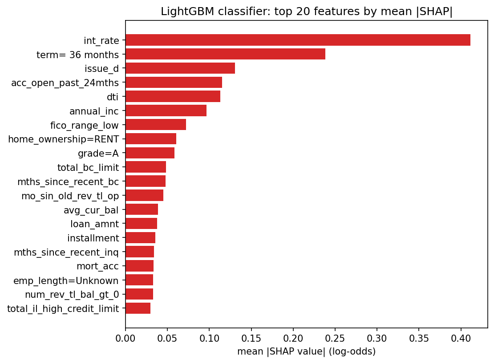

# Extension: LightGBM gradient boosting

This goes beyond the paper, which uses logistic regression, neural networks and random forests but no gradient boosting. LightGBM is trained on exactly the same features, train/test split and labels as the replication, tuned with a small grid and early stopping on a validation split of the training data (setup and chosen values: `ASSUMPTIONS.md`, section "Extension"). The replication results in `results/RESULTS.md` are not changed by it. All numbers are on the test set unless stated.

## 1. Classification

| Model | Default P / R / F1 | Paid Off P / R / F1 | Weighted F1 | Test AUC |
|---|---|---|---:|---:|
| Logistic Regression | 0.31 / 0.67 / 0.42 | 0.90 / 0.66 / 0.76 | 0.70 | not computed |
| Neural Network | 0.49 / 0.12 / 0.19 | 0.83 / 0.97 / 0.89 | 0.76 | not computed |
| Random Forest | 0.58 / 0.06 / 0.11 | 0.82 / 0.99 / 0.90 | 0.75 | 0.720 |
| **LightGBM (extension)** | 0.32 / 0.67 / 0.43 | 0.90 / 0.68 / 0.77 | 0.71 | 0.736 |

The paper reports weighted F1 of 0.88 to 0.89 for its three classifiers and the poster an AUC of 0.94; see `results/RESULTS.md` for why the replication is far below that.

LightGBM train weighted F1: 0.72. Chosen hyperparameters: num_leaves 63, learning_rate 0.05, min_child_samples 200, n_estimators 383 (tuning table: `tables/06_clf_tuning.md`).

## 2. Regression on net annualized return

| Model | Train MSE | Train R2 | Test MSE | Test R2 |
|---|---:|---:|---:|---:|
| Linear Regression | 0.0526 | 0.039 | 0.0525 | 0.034 |
| Ridge (alpha=1) | 0.0526 | 0.039 | 0.0525 | 0.034 |
| Neural Network | 0.0483 | 0.117 | 0.0542 | 0.004 |
| Random Forest, depth 4 | 0.0530 | 0.030 | 0.0528 | 0.030 |
| Random Forest, depth 8 | 0.0518 | 0.053 | 0.0523 | 0.039 |
| Random Forest, depth 10 | 0.0506 | 0.075 | 0.0522 | 0.040 |
| **LightGBM (extension)** | 0.0489 | 0.107 | 0.0515 | 0.053 |

Same NAR label and the same excluded loans as `04_regression.py`. Chosen hyperparameters: num_leaves 63, learning_rate 0.05, min_child_samples 200, n_estimators 370 (tuning table: `tables/06_reg_tuning.md`). The paper's best test R2 is 0.315.

## 3. Loan selection

Same logic as `05_loan_selection.py`: invest $25 in every loan with predicted NAR above M.

| Model | Split | Loans with predicted NAR > 0.132 | Mean actual NAR of those loans |
|---|---|---:|---:|
| RF depth 10 (replication) | train | 0.001% (3 loans) | 114.5% |
| RF depth 10 (replication) | test | 0.001% (3 loans) | -33.1% |
| LightGBM (extension) | train | 0.010% (57 loans) | 17.8% |
| LightGBM (extension) | test | 0.012% (29 loans) | 11.1% |

Paper: about 1.76% of loans selected with about 15% return.

Threshold sweep on the test set:

| M | RF depth 10 (replication): % selected | RF depth 10 (replication): NAR | LightGBM (extension): % selected | LightGBM (extension): NAR |
|---:|---:|---:|---:|---:|
| 0.05 | 0.181% | 6.0% | 8.306% | 6.0% |
| 0.06 | 0.002% | -23.4% | 3.693% | 6.9% |
| 0.07 | 0.002% | -23.4% | 1.573% | 7.6% |
| 0.08 | 0.002% | -23.4% | 0.670% | 9.0% |
| 0.09 | 0.001% | -33.1% | 0.309% | 9.3% |
| 0.10 | 0.001% | -33.1% | 0.146% | 9.9% |
| 0.11 | 0.001% | -33.1% | 0.061% | 12.5% |
| 0.12 | 0.001% | -33.1% | 0.032% | 12.2% |
| 0.13 | 0.001% | -33.1% | 0.014% | 11.6% |
| 0.14 | 0.001% | -41.6% | 0.008% | 8.7% |
| 0.15 | 0.001% | -41.6% | 0.004% | 9.7% |
| 0.16 | 0.001% | -41.6% | 0.001% | 13.4% |
| 0.17 | 0.001% | -41.6% | 0.000% | n/a |
| 0.18 | 0.001% | -41.6% | 0.000% | n/a |
| 0.19 | 0.001% | -41.6% | 0.000% | n/a |
| 0.20 | 0.001% | -41.6% | 0.000% | n/a |

Because few predictions reach these thresholds, the ranking is easier to judge by fixed shares: mean actual NAR of the best-ranked test loans.

| Model | top 1.00% | top 1.76% | top 5.00% | top 10.00% | top 25.00% | all loans |
|---|---:|---:|---:|---:|---:|---:|
| RF depth 10 (replication) | 6.4% | 5.9% | 5.7% | 4.9% | 4.1% | 0.2% |
| LightGBM (extension) | 8.3% | 7.6% | 6.6% | 5.9% | 4.8% | 0.2% |

## 4. Explainability (SHAP)

SHAP TreeExplainer on the LightGBM classifier for a random sample of up to 10,000 test loans. Positive SHAP values push the prediction towards "Paid Off". Feature values are standardized, and one-hot features are named `column=level`.

| Rank | LightGBM feature | Mean \|SHAP\| | Also in RF top 20 | Random Forest feature | RF importance |
|---:|---|---:|---|---|---:|
| 1 | int_rate | 0.4115 | yes | int_rate | 0.0287 |
| 2 | term= 36 months | 0.2383 |  | dti | 0.0223 |
| 3 | issue_d | 0.1307 | yes | annual_inc | 0.0192 |
| 4 | acc_open_past_24mths | 0.1150 |  | bc_open_to_buy | 0.0188 |
| 5 | dti | 0.1130 | yes | earliest_cr_line | 0.0186 |
| 6 | annual_inc | 0.0963 | yes | tot_hi_cred_lim | 0.0186 |
| 7 | fico_range_low | 0.0722 |  | avg_cur_bal | 0.0186 |
| 8 | home_ownership=RENT | 0.0605 |  | installment | 0.0185 |
| 9 | grade=A | 0.0585 |  | revol_bal | 0.0184 |
| 10 | total_bc_limit | 0.0484 | yes | revol_util | 0.0183 |
| 11 | mths_since_recent_bc | 0.0480 |  | total_bc_limit | 0.0183 |
| 12 | mo_sin_old_rev_tl_op | 0.0449 | yes | bc_util | 0.0183 |
| 13 | avg_cur_bal | 0.0386 | yes | mo_sin_old_rev_tl_op | 0.0182 |
| 14 | loan_amnt | 0.0374 |  | tot_cur_bal | 0.0180 |
| 15 | installment | 0.0356 | yes | total_bal_ex_mort | 0.0177 |
| 16 | mths_since_recent_inq | 0.0339 |  | total_rev_hi_lim | 0.0176 |
| 17 | mort_acc | 0.0332 |  | mo_sin_old_il_acct | 0.0172 |
| 18 | emp_length=Unknown | 0.0330 |  | issue_d | 0.0170 |
| 19 | num_rev_tl_bal_gt_0 | 0.0328 |  | total_il_high_credit_limit | 0.0158 |
| 20 | total_il_high_credit_limit | 0.0299 | yes | funded_amnt_inv | 0.0157 |

9 of LightGBM's top 20 features are also in the Random Forest's top 20. The two measures are not the same quantity: SHAP measures the average size of a feature's contribution to individual predictions, while the forest's importance measures how much the feature reduces Gini impurity.

**Reading the plots.** The interest rate is by far the strongest driver: high rates push a loan
towards "Default", low rates towards "Paid Off". A 36-month term pushes towards "Paid Off" (so 60-month loans
towards default). Later issue dates, more accounts opened in the past 24 months, a higher debt-to-income ratio,
renting and an unknown employment length push towards default; higher income, a higher FICO score and grade A push
towards "Paid Off". These directions are what credit-risk intuition predicts, with one caveat: the effect of
`issue_d` partly reflects how the dataset was built, because recently issued loans are only in the "final status"
sample if they ended early. The Random Forest's impurity importances are spread almost evenly over the
continuous credit-bureau variables (all between 0.016 and 0.029) and contain no one-hot level, while SHAP gives
weight to `term`, `grade` and `home_ownership` levels; impurity importance is known to favour continuous features
with many split points, so the two rankings should not be expected to agree.

## 5. Summary: how much does LightGBM improve on the paper's models?

- Classification: test AUC 0.736 for LightGBM against 0.720 for the replication's Random Forest (+0.016).
- Weighted F1 is 0.71 for LightGBM against 0.75 for the Random Forest; note that LightGBM uses balanced class weights like the logistic regression, so its precision/recall trade-off is closer to the logistic regression's than to the forest's.
- Regression: test R2 0.053 for LightGBM against 0.040 for the best replication model (Random Forest, depth 10), a difference of +0.013.
- Loan selection: the best-ranked 1.76% of test loans (the share the paper invests in) return 7.6% with LightGBM against 5.9% with RF depth 10; investing in every loan returns 0.2%. The paper reports about 15%.

**Overall.** LightGBM beats the replication's Random Forest on AUC, every replication regressor on test R2, and
RF depth 10 on the return of the best-ranked loans, but the gains are small and nowhere near the paper's reported numbers (AUC 0.94 on the
poster, test R2 0.315, 15% return on 1.76% of loans). A stronger algorithm on the same features does not close
that gap, which is consistent with the gap being about the information in the features and not about the model
class; it does not prove it.

Points to keep in mind:

- LightGBM's weighted F1 is *lower* than the Random Forest's. That is a consequence of the balanced class
  weights, not of a worse model: the forest reaches its weighted F1 by predicting "Paid Off" for almost every
  loan (it finds about 6% of the defaults), while LightGBM finds about two thirds of them. Against the logistic
  regression, which uses the same weighting, LightGBM is only marginally better (weighted F1 0.71 against 0.70,
  with practically the same recall on defaults).
- At the paper's threshold M = 0.132 LightGBM selects only a few dozen loans, so the return at that exact
  threshold still rests on a small number of loans. The fixed-share table and the figure are the more reliable
  comparison.
- The chosen configuration lies at the edge of the small grid (lowest learning rate, largest
  `min_child_samples`), so a wider search might add a little. All results come from one train/test split, without
  confidence intervals.

## 6. Runtime of this run

| Step | Seconds |
|---|---:|
| clf: final fit | 41 |
| clf: tuning | 165 |
| reg: final fit | 29 |
| reg: tuning | 134 |
| shap | 10 |
